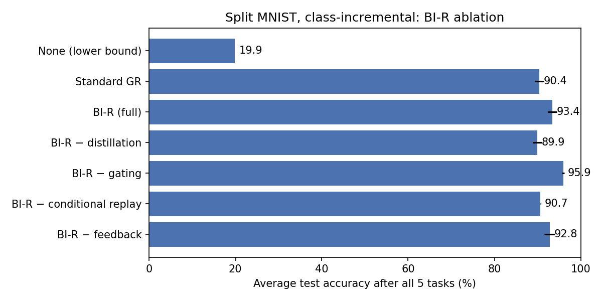

# Brain-Inspired Replay on Split MNIST: a component ablation

This repository reproduces brain-inspired replay (BI-R; van de Ven, Siegelmann & Tolias, 2020, *Nature Communications*) on **class-incremental Split MNIST** and removes its components one at a time to see how much each one contributes.

The ablation in the original paper was done on permuted MNIST and split CIFAR-100, and BI-R was not evaluated on class-incremental Split MNIST. This is a small experiment to fill that gap.

All runs use the original code from [GMvandeVen/brain-inspired-replay](https://github.com/GMvandeVen/brain-inspired-replay) without changes; only the command-line options differ between configurations.

## Setup

- **Task:** Split MNIST, 5 tasks with 2 digits each, class-incremental scenario (the model must tell apart all 10 digits at test time without task labels).
- **Model:** default fully connected network (2 × 400 units) and VAE-based generator, default hyperparameters of the repository.
- **Seeds:** 3 per configuration (1, 2, 3).
- **Metric:** average test accuracy over all 10 classes after training on all 5 tasks.

On MNIST there are no convolutional layers, so BI-R here consists of four components: replay-through-feedback, conditional replay (GMM prior per class), context gates in the decoder, and distillation. Internal replay, which had the largest effect in the paper's CIFAR-100 ablation, cannot be tested in this setting.

| Configuration | Options |
|---|---|
| None (lower bound) | *(no replay)* |
| Standard GR | `--replay=generative` |
| BI-R (full) | `--replay=generative --brain-inspired` |
| BI-R − distillation | `--replay=generative --feedback --prior=GMM --per-class --dg-gates` |
| BI-R − gating | `--replay=generative --feedback --prior=GMM --per-class --distill` |
| BI-R − conditional replay | `--replay=generative --feedback --dg-gates --distill` |
| BI-R − feedback | `--replay=generative --prior=GMM --per-class --dg-gates --distill` |

## Results

| Configuration | Accuracy (%) | Difference to full BI-R |
|---|---|---|
| None (lower bound) | 19.85 ± 0.03 | −73.5 |
| Standard GR | 90.36 ± 1.06 | −3.0 |
| **BI-R (full)** | **93.38 ± 1.05** | — |
| BI-R − distillation | 89.94 ± 1.01 | −3.4 |
| BI-R − conditional replay | 90.66 ± 0.09 | −2.7 |
| BI-R − feedback | 92.80 ± 1.20 | −0.6 |
| BI-R − gating | 95.92 ± 0.32 | +2.5 |

Mean ± standard deviation over 3 seeds.

## Observations

1. Full BI-R improves on standard generative replay by about 3 points.
2. Distillation and conditional replay carry most of this gain: removing either one brings accuracy back to roughly the level of standard GR.
3. Removing replay-through-feedback makes little difference, which matches the paper's finding on CIFAR-100 that its main benefit is efficiency (no separate generator).
4. **Removing the decoder gates improved accuracy** (95.9% vs 93.4%), with low variance across seeds. In the paper, gating was needed on CIFAR-100.

A possible explanation for (4): for Split MNIST the repository's default gating proportion is `dg_prop = 0.8`, so each class is generated with only about 20% of the 400 decoder units. In such a small decoder this may limit replay quality more than gating helps against interference. This is a hypothesis; a natural next step is to sweep `--dg-prop` (for example 0.2, 0.5, 0.8).

## Limitations

- Only 3 seeds per configuration. With Welch's t-test against full BI-R, p-values are between 0.03 and 0.07 for the four components that changed accuracy by more than 2 points and 0.63 for feedback, so the results should be read as indications, not firm conclusions.
- Internal replay could not be tested because the MNIST models have no convolutional layers.
- Default hyperparameters were used for every configuration; removing a component might call for retuning the others.

## Reproduce

Open `bir_ablation_splitMNIST.ipynb` in Google Colab, select a GPU runtime, and run all cells. The notebook clones the original repository, runs the 7 configurations × 3 seeds, and saves `ablation_results.csv`, `ablation_plot.png` and the logs.

## Reference

van de Ven, G. M., Siegelmann, H. T., & Tolias, A. S. (2020). Brain-inspired replay for continual learning with artificial neural networks. *Nature Communications*, 11, 4069.
# Brain-Inspired Replay on Split MNIST: a component ablation

This repository reproduces brain-inspired replay (BI-R; van de Ven, Siegelmann & Tolias, 2020, *Nature Communications*) on **class-incremental Split MNIST** and removes its components one at a time to see how much each one contributes.

The ablation in the original paper was done on permuted MNIST and split CIFAR-100, and BI-R was not evaluated on class-incremental Split MNIST. This is a small experiment to fill that gap.

All runs use the original code from [GMvandeVen/brain-inspired-replay](https://github.com/GMvandeVen/brain-inspired-replay) without changes; only the command-line options differ between configurations.

## Setup

- **Task:** Split MNIST, 5 tasks with 2 digits each, class-incremental scenario (the model must tell apart all 10 digits at test time without task labels).
- **Model:** default fully connected network (2 × 400 units) and VAE-based generator, default hyperparameters of the repository.
- **Seeds:** 3 per configuration (1, 2, 3).
- **Metric:** average test accuracy over all 10 classes after training on all 5 tasks.

On MNIST there are no convolutional layers, so BI-R here consists of four components: replay-through-feedback, conditional replay (GMM prior per class), context gates in the decoder, and distillation. Internal replay, which had the largest effect in the paper's CIFAR-100 ablation, cannot be tested in this setting.

| Configuration | Options |
|---|---|
| None (lower bound) | *(no replay)* |
| Standard GR | `--replay=generative` |
| BI-R (full) | `--replay=generative --brain-inspired` |
| BI-R − distillation | `--replay=generative --feedback --prior=GMM --per-class --dg-gates` |
| BI-R − gating | `--replay=generative --feedback --prior=GMM --per-class --distill` |
| BI-R − conditional replay | `--replay=generative --feedback --dg-gates --distill` |
| BI-R − feedback | `--replay=generative --prior=GMM --per-class --dg-gates --distill` |

## Results

| Configuration | Accuracy (%) | Difference to full BI-R |
|---|---|---|
| None (lower bound) | 19.85 ± 0.03 | −73.5 |
| Standard GR | 90.36 ± 1.06 | −3.0 |
| **BI-R (full)** | **93.38 ± 1.05** | — |
| BI-R − distillation | 89.94 ± 1.01 | −3.4 |
| BI-R − conditional replay | 90.66 ± 0.09 | −2.7 |
| BI-R − feedback | 92.80 ± 1.20 | −0.6 |
| BI-R − gating | 95.92 ± 0.32 | +2.5 |

Mean ± standard deviation over 3 seeds.

## Observations

1. Full BI-R improves on standard generative replay by about 3 points.
2. Distillation and conditional replay carry most of this gain: removing either one brings accuracy back to roughly the level of standard GR.
3. Removing replay-through-feedback makes little difference, which matches the paper's finding on CIFAR-100 that its main benefit is efficiency (no separate generator).
4. **Removing the decoder gates improved accuracy** (95.9% vs 93.4%), with low variance across seeds. In the paper, gating was needed on CIFAR-100.

A possible explanation for (4): for Split MNIST the repository's default gating proportion is `dg_prop = 0.8`, so each class is generated with only about 20% of the 400 decoder units. In such a small decoder this may limit replay quality more than gating helps against interference. This is a hypothesis; a natural next step is to sweep `--dg-prop` (for example 0.2, 0.5, 0.8).

## Limitations

- Only 3 seeds per configuration. With Welch's t-test against full BI-R, p-values are between 0.03 and 0.07 for the four components that changed accuracy by more than 2 points and 0.63 for feedback, so the results should be read as indications, not firm conclusions.
- Internal replay could not be tested because the MNIST models have no convolutional layers.
- Default hyperparameters were used for every configuration; removing a component might call for retuning the others.

## Reproduce

Open `bir_ablation_splitMNIST.ipynb` in Google Colab, select a GPU runtime, and run all cells. The notebook clones the original repository, runs the 7 configurations × 3 seeds, and saves `ablation_results.csv`, `ablation_plot.png` and the logs.

## Reference

van de Ven, G. M., Siegelmann, H. T., & Tolias, A. S. (2020). Brain-inspired replay for continual learning with artificial neural networks. *Nature Communications*, 11, 4069.
